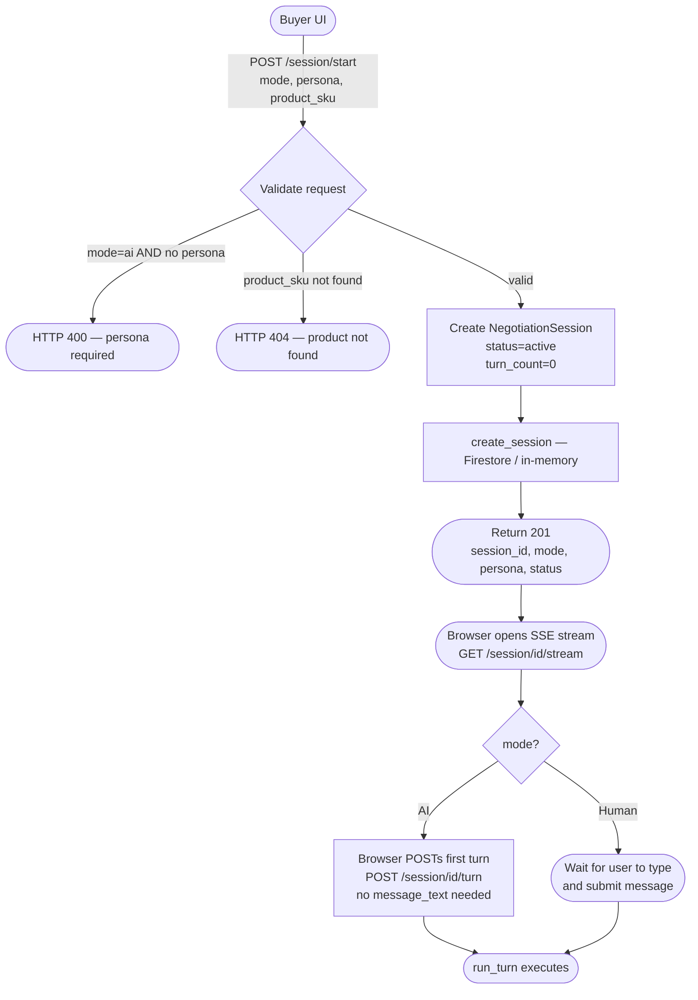
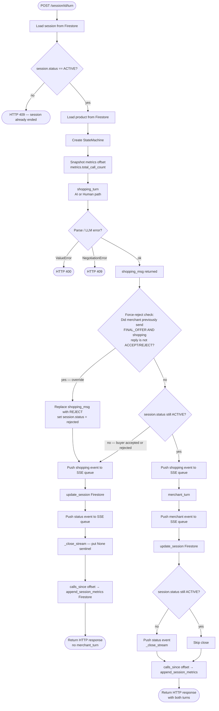
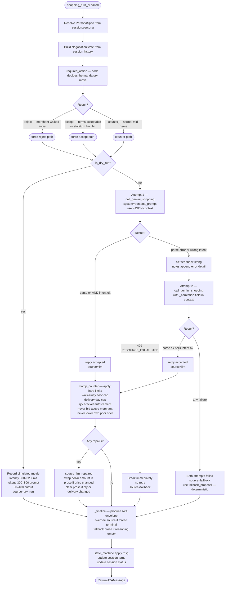
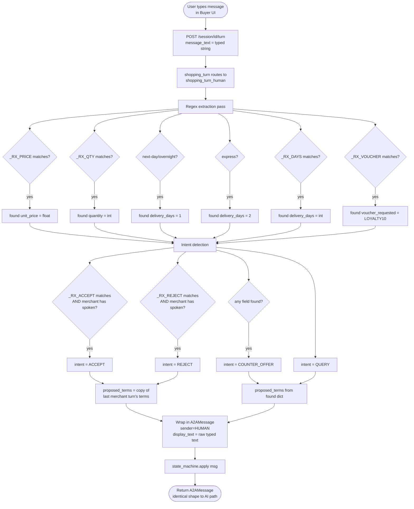
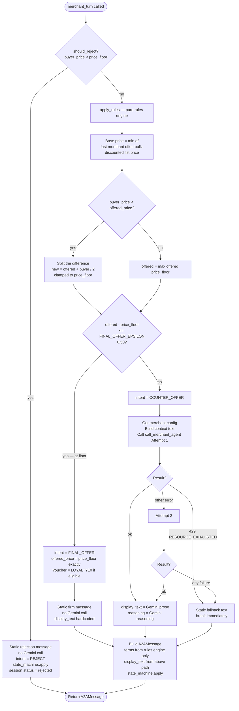
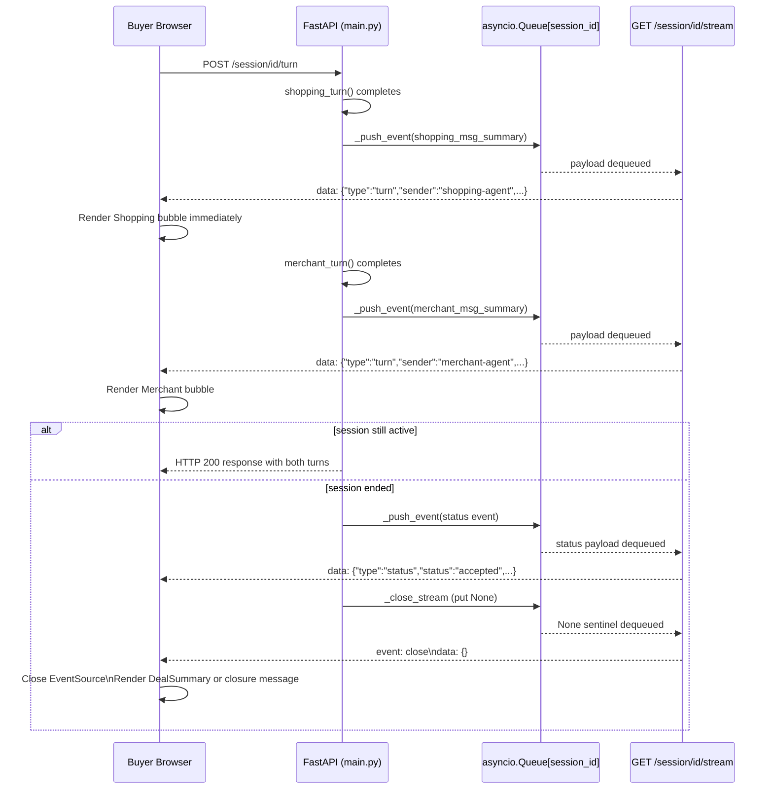
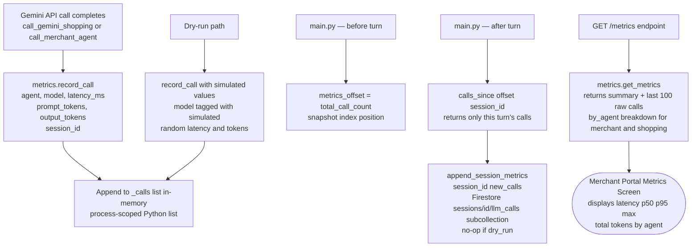

# NegotiateIQ — End-to-End Flow (All Branches)

> **Audience:** Developers who need to trace every code path through the system.
> **Last updated:** 2026-10-11

---

## 1. Overview

NegotiateIQ is a multi-agent price-negotiation platform built on the A2A (Agent-to-Agent) protocol. A buyer-side Shopping Agent (AI or Human) negotiates with a rule-governed Merchant Agent over a product's price, quantity, delivery terms, and optional vouchers. The FastAPI orchestrator (port 8001) owns session lifecycle, sequencing, and persistence; two React+Vite UIs serve the buyer (port 5173) and merchant (port 5174). Gemini 3.5 Flash powers both AI agents, with all hard limits enforced by deterministic rules engines so Gemini controls only prose and negotiation judgment—never numbers. Real-time turn-by-turn updates are delivered to the browser via Server-Sent Events (SSE). Sessions transition through the status chain `active → accepted | rejected | expired`, with Firestore (or an in-memory dry-run fallback) storing the session document and LLM call metrics in a subcollection. Every code path—AI auto-play, human typing, LLM quota failure, force-reject override, stall detection, and dry-run simulation—converges on the same A2AMessage shape so the rest of the system is unaffected by which path ran.

---

## 2. Session Start Flow

**Key implementation notes:**
- `StartSessionRequest` is validated by `main.py:start_session()`.
- Persona is required only in AI mode; it is `None` in Human mode.
- The SSE stream (`GET /session/{id}/stream`) uses an `asyncio.Queue` keyed by `session_id`. The queue is created lazily on first access so both the stream opener and the turn runner share the same queue instance.
- In AI mode the browser fires the first `POST /session/{id}/turn` immediately after opening the SSE stream—there is no explicit trigger on the server side.

---

## 3. Full Turn Execution Flow

`POST /session/{session_id}/turn` → `main.py:run_turn()`

**Source references:** `main.py` lines 427–521.

---

## 4. Shopping Agent — AI Mode Flow

`shopping.py:shopping_turn_ai()`

**Key source references:**
- `required_action()` — `shopping.py` lines 382–403
- LLM retry loop — `shopping.py` lines 821–855
- `clamp_counter()` — `shopping.py` lines 416–466
- `fallback_proposal()` — `shopping.py` lines 469–496
- `_finalize()` — `shopping.py` lines 581–670

**Source field values:** `llm` | `llm_repaired` | `override` | `fallback` | `dry_run`

**Turn/stall limits by persona:**

| Persona | Turn limit | Stall limit |
|---|---|---|
| budget_shopper | 8 | 3 |
| premium_buyer | 5 | 2 |
| bulk_purchaser | 6 | 2 |

---

## 5. Shopping Agent — Human Mode Flow

`shopping.py:shopping_turn_human()`

**Key point:** Human and AI paths produce identical `A2AMessage` shapes. The Merchant Agent cannot distinguish which path ran.

---

## 6. Merchant Agent Flow

`merchant.py:merchant_turn()`

**Key rules engine facts:**
- `FINAL_OFFER_EPSILON = 0.50` (defined in `merchant.py` line 62)
- Delivery: defaults to 5 days; switches to 2 days if buyer requested faster than 5 days
- Voucher `LOYALTY10` is added only on `FINAL_OFFER` if `product.vouchers_eligible` is true
- Gemini controls only prose; `terms` always come from `apply_rules()`

---

## 7. Session End Scenarios

| # | Trigger | Who triggers | `session.status` | `final_deal` populated | What the user sees |
|---|---|---|---|---|---|
| 1 | Shopping Agent (AI or Human) sends `ACCEPT` | Buyer side | `accepted` | Yes — last merchant terms copied to `final_deal` | DealSummary card with agreed price, qty, delivery, optional voucher |
| 2 | Shopping Agent (AI or Human) sends `REJECT` | Buyer side | `rejected` | No | "Negotiation closed" message in NegotiationScreen |
| 3 | Merchant Agent sends `REJECT` (buyer below price floor) | Merchant side via `should_reject()` | `rejected` | No | Merchant's rejection message rendered; stream closes |
| 4 | Turn limit reached for persona (budget=8, premium=5, bulk=6) | `required_action()` in shopping.py | `expired` | No (if rejected) / Yes (if final merchant terms were acceptable) | "Session expired" status; no further turns possible |
| 5 | Merchant sent `FINAL_OFFER`, shopping counters rather than accept/reject | `main.py` force-reject override | `rejected` | No | Shopping bubble shows override text: "The merchant's final price could not be matched." |

**StateMachine transitions** are enforced in `state_machine.py` and called via `state_machine.apply(msg)` at the end of both `shopping_turn_ai` and `merchant_turn`.

---

## 8. Real-Time SSE Event Flow

**SSE event shapes:**

| Event type | Fields |
|---|---|
| `turn` | `type, turn, sender, intent, display_text, proposed_terms` |
| `status` | `type, status, final_deal` |
| `close` | SSE event named `close`, empty data `{}` |

**Implementation:** The SSE generator (`main.py:stream_session`) loops on `await queue.get()`. A `None` sentinel is the only way to break the loop and close the stream cleanly. The queue is in-memory; safe for single-instance Cloud Run (demo scale).

---

## 9. Metrics Collection Flow

**In-memory store details:**
- `_calls` is a module-level Python list in `metrics.py`; it resets on server restart.
- `total_call_count()` returns `len(_calls)` — used as a snapshot offset before each turn.
- `calls_since(offset, session_id)` slices `_calls[offset:]` and filters by session_id.
- The Firestore write (`append_session_metrics`) is a no-op when `DRY_RUN=true`.
- The `/metrics` endpoint returns the last 100 raw call records plus summary stats (avg, p50, p95, max latency; total prompt and output tokens).

---

## 10. Dry-Run vs Live Mode

`DRY_RUN` is read from the environment variable. It is checked in `gemini.py:is_dry_run()` and in `shopping.py:shopping_turn_ai()`.

| Component | `DRY_RUN=false` (Live) | `DRY_RUN=true` (Dry-run) |
|---|---|---|
| **Shopping Agent LLM** | Calls Gemini with persona prompt; up to 2 attempts; retry with feedback; 429 breaks immediately | Skips Gemini entirely; uses `fallback_proposal()` deterministically |
| **Shopping Agent metrics** | Real latency and token counts recorded via `record_call()` | Simulated `record_call()` with random latency (500–2200ms) and random token counts; model name tagged `[simulated]` |
| **Shopping Agent source** | `llm` / `llm_repaired` / `override` / `fallback` | `dry_run` |
| **Merchant Agent LLM** | Calls Gemini for prose; up to 2 attempts; static fallback on failure | Not affected — merchant always calls Gemini unless `FINAL_OFFER` or below-floor reject; no dry-run bypass in merchant path |
| **Firestore session persistence** | `create_session`, `update_session`, `get_session` write/read Firestore documents | Falls back to in-memory dict store if Firestore unavailable (controlled in `firebase_db.py`) |
| **Firestore metrics persistence** | `append_session_metrics` writes to `sessions/{id}/llm_calls` subcollection | `append_session_metrics` is a no-op — no Firestore writes for metrics |
| **GET /metrics** | Returns real call records from `_calls` list | Returns records with simulated values — dashboard is populated but shows fake numbers |
| **Session lifecycle** | Full turn loop; all end conditions apply | Full turn loop; all end conditions apply — dry-run only affects Gemini bypass and metrics persistence |
| **SSE stream** | Real-time push as turns complete | Same — SSE is not affected by dry-run mode |

---

## Appendix: Key File Map

| File | Role |
|---|---|
| `orchestrator/src/main.py` | FastAPI app; `run_turn`; SSE queue management; all HTTP endpoints |
| `orchestrator/src/shopping.py` | Shopping Agent; persona specs; `required_action`; `clamp_counter`; `fallback_proposal`; human regex parser |
| `orchestrator/src/merchant.py` | Merchant Agent; `apply_rules`; `should_reject`; Gemini prose call |
| `orchestrator/src/gemini.py` | Gemini client wrappers; `is_dry_run`; `call_gemini_shopping`; `call_merchant_agent` |
| `orchestrator/src/metrics.py` | In-memory LLM call store; `record_call`; `calls_since`; `get_metrics` |
| `orchestrator/src/firebase_db.py` | Firestore CRUD; `append_session_metrics`; in-memory fallback |
| `orchestrator/src/models.py` | Pydantic models: `NegotiationSession`, `A2AMessage`, `ProposedTerms`, enums |
| `orchestrator/src/state_machine.py` | `StateMachine`; enforces legal intent transitions; sets `session.status` and `final_deal` |
| `ui/src/MerchantApp.jsx` | Merchant React root |
| `ui/src/api.js` | Buyer UI API calls |
| `ui/src/components/NegotiationScreen.jsx` | Buyer turn UI; SSE EventSource; renders turn bubbles and DealSummary |
| `ui/src/components/MerchantMetricsScreen.jsx` | Merchant metrics dashboard |
