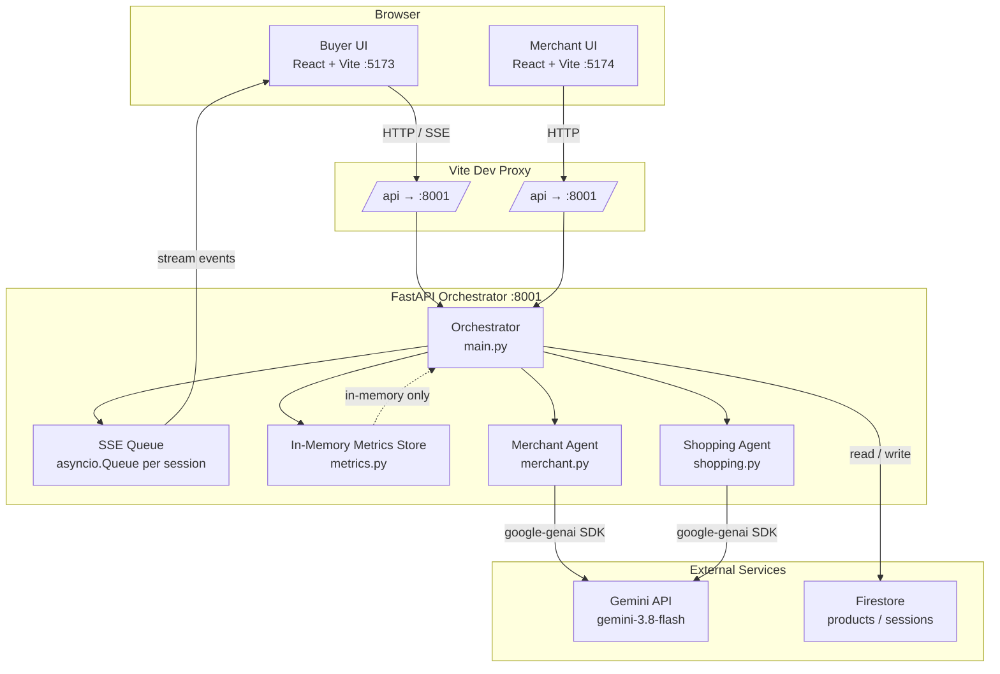
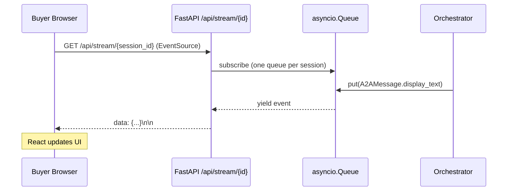
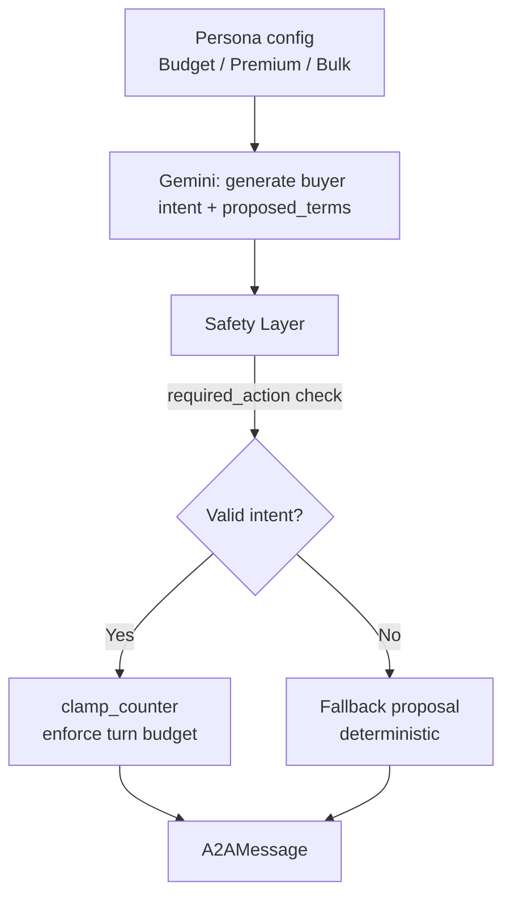
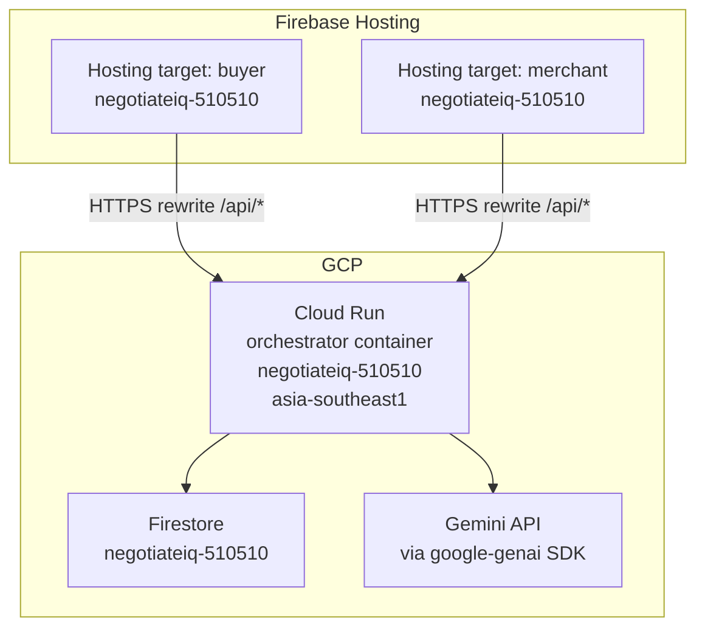

# NegotiateIQ — Solution Architecture

Audience: technical reviewer or new team member.

---

## 1. System Overview

NegotiateIQ is a real-time, AI-powered price-negotiation platform built on the **Agent-to-Agent (A2A) protocol**. A buyer-facing React app lets a user pick a product and a shopping persona; a FastAPI orchestrator then runs two autonomous Gemini-powered agents — a **Shopping Agent** (acting on the buyer's behalf) and a **Merchant Agent** (defending the seller's rules) — that exchange structured A2A messages until a deal is reached or the turn budget is exhausted. The merchant-facing React app provides a live dashboard for product configuration, session inspection, and LLM-call metrics. Persistence is handled by Firestore; real-time updates are streamed to both browsers via Server-Sent Events (SSE). The entire backend runs as a single Cloud Run container; the two UIs are hosted on Firebase Hosting.

---

## 2. High-Level Architecture Diagram



---

## 3. Component Breakdown

### 3.1 Buyer UI (`ui/` — Vite port 5173)

- React + Vite single-page app.
- Entry point: `ui/src/main.jsx` with `ui/vite.config.js`.
- Screens: product catalogue, negotiation view (live A2A message feed), deal summary.
- All backend calls go through Vite's dev proxy (`/api` → `http://localhost:8001`); no CORS configuration needed in development.
- In production, Firebase Hosting rewrite rules serve the same routing.

### 3.2 Merchant UI (`ui/` — Vite port 5174)

- Second React + Vite app, same source tree, different entry point and config file (`ui/vite.merchant.config.js`).
- Launched with `npm run dev:merchant`.
- Screens: product configuration, session list, per-session LLM metrics, negotiation replay.
- Password-gated on the frontend with the demo password `merchant123` (hardcoded; not a production security boundary).

### 3.3 FastAPI Orchestrator (`orchestrator/src/main.py`)

- Single Python process, async throughout.
- Manages session lifecycle: creates sessions, invokes agents in turn order, fans events into SSE queues, aggregates metrics.
- Exposes REST endpoints (`/api/products`, `/api/sessions`, `/api/negotiate`, `/api/metrics`) and an SSE endpoint (`/api/stream/{session_id}`).
- Reads configuration exclusively from environment variables (via `orchestrator/.env` locally; Cloud Run env vars in production).

### 3.4 Merchant Agent (`orchestrator/src/merchant.py`)

Two-layer design (see Section 7.1).

### 3.5 Shopping Agent (`orchestrator/src/shopping.py`)

Persona-driven with a code safety pipeline (see Section 7.2).

### 3.6 Gemini Integration (`orchestrator/src/gemini.py`)

- Wraps the `google-genai` SDK.
- Handles prompt construction, response parsing, latency measurement, and token counting.
- Writes one `llm_calls` record to Firestore (or in-memory) per invocation.
- `DRY_RUN=true` short-circuits every call and returns a deterministic simulated response.

---

## 4. A2A Message Protocol

All inter-agent messages use the `A2AMessage` Pydantic model defined in `orchestrator/src/models.py`. This is the single data contract that both agents read and write.

```python
class A2AMessage(BaseModel):
    session_id: str
    turn: int
    sender: str          # "shopping-agent" | "merchant-agent" | "human"
    receiver: str
    intent: str          # "counter_offer" | "final_offer" | "accept" | "reject" | "query"
    proposed_terms: ProposedTerms
    display_text: str    # Natural-language prose shown in the UI
    reasoning: str       # Internal reasoning, logged but not shown to buyer
```

`ProposedTerms` fields:

| Field | Type | Description |
|-------|------|-------------|
| `unit_price` | float | Price per unit being proposed |
| `quantity` | int | Units requested |
| `delivery_days` | int | Requested delivery window |
| `voucher_requested` | bool | Whether a discount voucher is requested |

The orchestrator logs every `A2AMessage` to the session's `turns[]` array in Firestore and fans the `display_text` field into the SSE stream.

---

## 5. Data Layer

### 5.1 Firestore Schema

**Collection: `products/{sku}`**

| Field | Type | Description |
|-------|------|-------------|
| `name` | string | Product display name |
| `list_price` | number | Standard retail price |
| `price_floor` | number | Minimum acceptable price (never shown to buyer) |
| `bulk_tiers` | array | Quantity thresholds and discount multipliers |
| `delivery_options` | array | Available delivery windows and costs |
| `vouchers_eligible` | bool | Whether vouchers can be applied |
| `image_url` | string | Product image URL |

**Collection: `sessions/{id}`**

| Field | Type | Description |
|-------|------|-------------|
| `session_id` | string | UUID |
| `mode` | string | Negotiation mode |
| `persona` | string | Shopping persona name |
| `product_sku` | string | Reference to products collection |
| `status` | string | `active` \| `completed` \| `rejected` |
| `turn_count` | int | Number of turns elapsed |
| `turns` | array | Ordered list of `A2AMessage` objects |
| `final_deal` | object | Agreed `ProposedTerms` if status is `completed` |
| `created_at` | timestamp | Session creation time |

**Subcollection: `sessions/{id}/llm_calls/{auto-id}`**

| Field | Type | Description |
|-------|------|-------------|
| `ts` | timestamp | Call timestamp |
| `agent` | string | `merchant-agent` or `shopping-agent` |
| `model` | string | Gemini model ID used |
| `latency_ms` | int | End-to-end latency in milliseconds |
| `prompt_tokens` | int | Input token count |
| `output_tokens` | int | Output token count |
| `session_id` | string | Parent session reference |

### 5.2 Dry-Run Mode

| Flag | Effect |
|------|--------|
| `FIREBASE_DRY_RUN=true` | All Firestore reads/writes are redirected to in-memory Python dicts. Data is lost on restart. |
| `DRY_RUN=true` | All Gemini calls are skipped; agents return deterministic simulated `A2AMessage` objects. |

Both flags can be combined. `FIREBASE_DRY_RUN=true` is the recommended setting for local development because it requires no GCP credentials.

---

## 6. Real-Time Communication — SSE



- Each active negotiation session has exactly one `asyncio.Queue` stored in a dict keyed by `session_id`.
- The orchestrator `put()`s a serialised event after every agent turn.
- The SSE endpoint holds the HTTP connection open and `yield`s each event as it arrives.
- When the session ends (accept / reject / turn budget exhausted) the orchestrator enqueues a terminal `done` event, and the browser closes the `EventSource`.
- No WebSocket library is required; SSE is native HTTP.

---

## 7. AI Agent Architecture

### 7.1 Merchant Agent — Two-Layer Design

```mermaid
flowchart LR
    subgraph Layer 1 — Rules Engine [Python, deterministic]
        R1[Check price floor]
        R2[Apply bulk tier discount]
        R3[Evaluate delivery option]
        R4[Voucher eligibility check]
        R1 --> R2 --> R3 --> R4
    end

    subgraph Layer 2 — Gemini [natural language only]
        G[Generate display_text prose]
    end

    IN[Incoming A2AMessage] --> Layer1
    R4 -->|approved terms| G
    G -->|display_text| OUT[Outgoing A2AMessage]
```

- **Layer 1 (Rules Engine):** Pure Python. Enforces all pricing logic deterministically: price floor compliance, bulk tier discounts, delivery option matching, voucher eligibility. The output of this layer is a fully computed `ProposedTerms` object with no Gemini involvement.
- **Layer 2 (Gemini):** Receives only the approved terms and the negotiation context. Its sole job is to write persuasive, natural-language `display_text` prose. It cannot alter prices or delivery terms.
- This design ensures that the merchant **never** accepts a deal below the price floor, regardless of what Gemini generates.

### 7.2 Shopping Agent — Safety Pipeline



**Personas and turn budgets:**

| Persona | Max turns | Strategy |
|---------|-----------|----------|
| Budget Shopper | 8 | Aggressive price pressure, voucher requests |
| Premium Buyer | 5 | Speed-focused, accepts higher price for fast delivery |
| Bulk Purchaser | 6 | Volume leverage, bulk tier negotiation |

**Safety layer fields:**

| Field | Purpose |
|-------|---------|
| `required_action` | Validates that Gemini returned a recognised `intent` value |
| `clamp_counter` | Halts the agent when the persona's turn budget is reached |
| `fallback_proposal` | Deterministic `A2AMessage` used when Gemini output fails validation |

Gemini generates the buyer's intent and terms; the safety layer ensures the agent always produces a structurally valid `A2AMessage` and never exceeds its turn limit.

---

## 8. Metrics and Observability

### In-Memory Metrics Store (`orchestrator/src/metrics.py`)

- Stores one record per LLM call: `session_id`, `agent`, `model`, `latency_ms`, `prompt_tokens`, `output_tokens`, `ts`.
- Exposed via `GET /api/metrics` (aggregate) and `GET /api/metrics/{session_id}` (per session).
- **Resets on every backend restart** — suitable for development; not for production.

### Firestore Metrics (when `FIREBASE_DRY_RUN=false`)

- Each LLM call writes a document to `sessions/{id}/llm_calls/{auto-id}`.
- Persists across restarts and enables historical trend analysis.
- The merchant dashboard reads from both sources and merges results.

---

## 9. Deployment Topology



- **Cloud Run:** single-container, single-instance deployment (sufficient for demo scale). Scales to zero when idle. Stateless except for the in-memory metrics store.
- **Firebase Hosting:** two named targets (`buyer` and `merchant`) defined in `firebase.json` and `.firebaserc`. Each serves its own built React bundle. URL rewrites forward `/api/*` traffic to the Cloud Run service URL.
- **Firestore:** native mode, region `asia-southeast1`, same GCP project (`negotiateiq-510510`).

---

## 10. Security and Configuration

### Environment Variables

All secrets and runtime toggles are injected via environment variables. No secrets appear in source code.

| Variable | Required | Description |
|----------|----------|-------------|
| `GEMINI_API_KEY` | Yes (live mode) | Google AI Studio API key; starts with `AIza` |
| `MERCHANT_MODEL` | No | Gemini model for Merchant Agent (default: `gemini-3.8-flash`) |
| `SHOPPING_MODEL` | No | Gemini model for Shopping Agent (default: `gemini-3.8-flash`) |
| `DRY_RUN` | No | `true` skips all Gemini calls (default: `false`) |
| `FIREBASE_DRY_RUN` | No | `true` skips Firestore, uses in-memory dicts (default: `false`) |
| `GCP_PROJECT` | Firestore only | GCP project ID |
| `GCP_REGION` | Firestore only | GCP region |

### Rules

- `orchestrator/.env` is listed in `.gitignore`. **Never commit it.**
- GCP service account JSON key files must also never be committed.
- `orchestrator/.env.example` contains placeholder values and is safe to commit; it documents the required variable names.
- The merchant portal password (`merchant123`) is a demo convenience gate only. It provides no real security and must be replaced before any production use.
- In production, Cloud Run should be configured with a service account that has the minimum IAM permissions required: Firestore read/write on the `negotiateiq-510510` project only.
